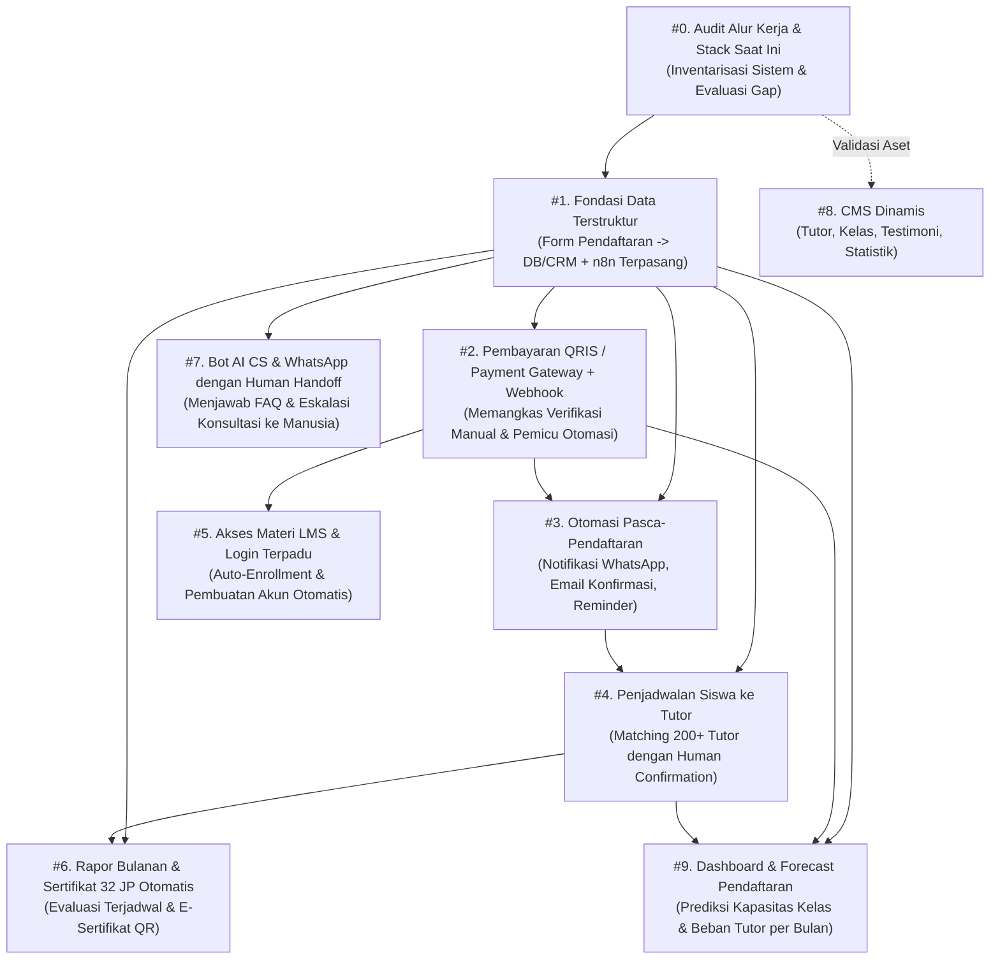
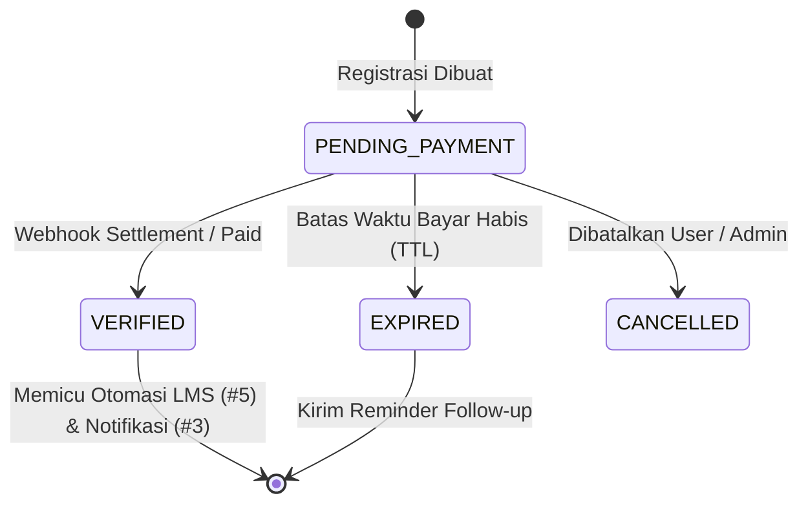
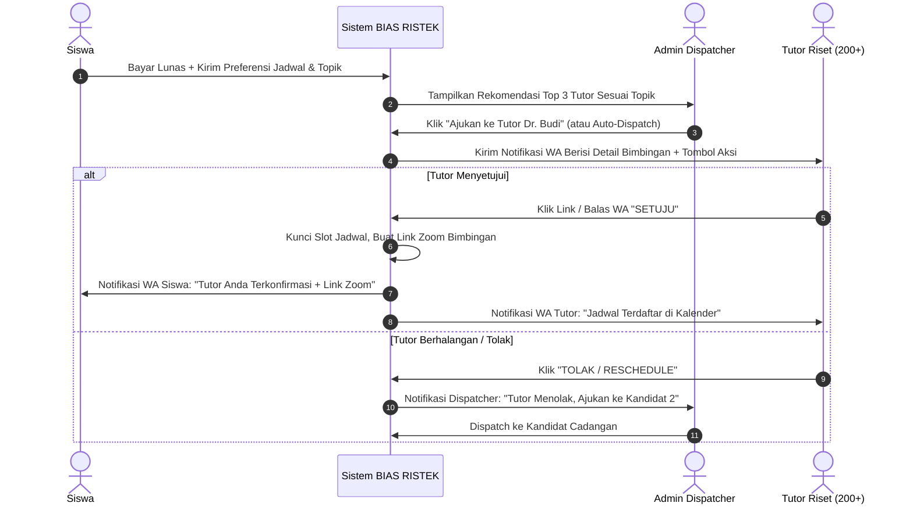
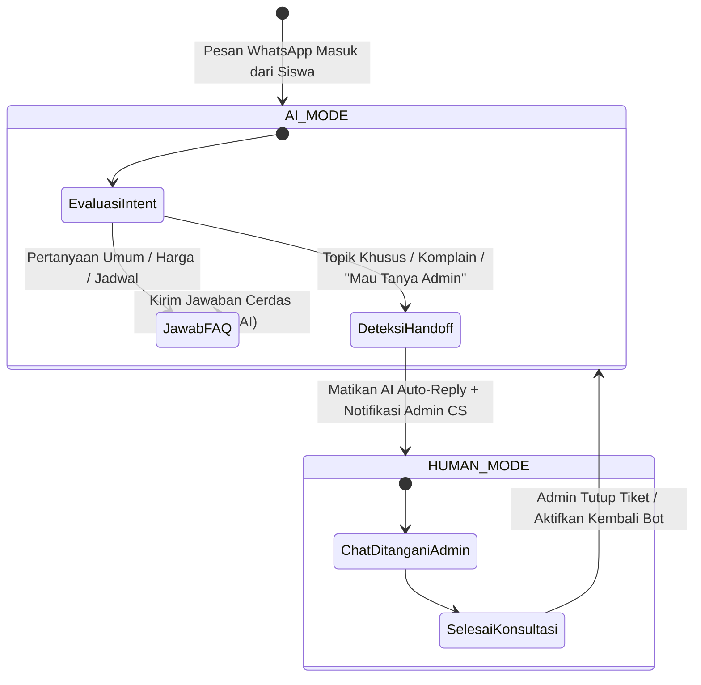
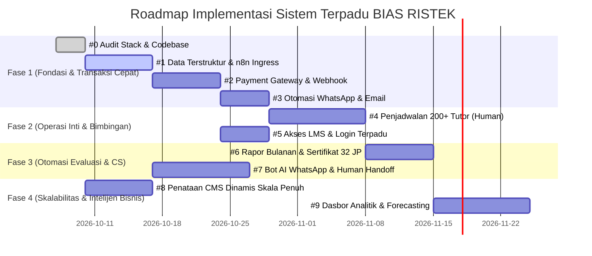

# PRODUCT REQUIREMENTS DOCUMENT (PRD)
## SISTEM OTOMASI & AKADEMIK TERPADU BIAS RISTEK
**Dokumen Spesifikasi Teknis & Roadmap Produk Berbasis Prioritas Ketergantungan**

---

| Atribut Dokumen | Rincian |
| :--- | :--- |
| **Nama Produk** | Platform Akademik & Otomasi Operasional BIAS RISTEK |
| **Versi Dokumen** | 1.0.0 (Production Blueprint) |
| **Status** | Approved & Ready for Phased Implementation |
| **Target Pengguna** | Tim Pengembang, Product Owner, Tim Operasional & Admin, 200+ Tutor Riset |
| **Arsitektur Dasar** | Next.js 16 (App Router), React 19, TypeScript, PostgreSQL (Supabase/Prisma), n8n Workflow Engine |
| **Design System** | Academic Innovation (`DESIGN.md`: Deep Research Blue `#001847`, Scholastic Gold `#fdbc13`, Plus Jakarta Sans & Inter) |
| **Terakhir Diperbarui** | Oktober 2026 |

---

## 1. Executive Summary & Visi Produk

### 1.1 Latar Belakang
**BIAS RISTEK** adalah lembaga pengembangan talenta riset dan bimbingan akademik intensif (skripsi, tesis S2, disertasi S3, publikasi Scopus/SINTA, serta analisis data statistik seperti SmartPLS, SPSS, SEM, NVivo, dan bibliometrik). 

Dengan pertumbuhan ekosistem yang menaungi lebih dari **200+ tutor pakar** dan model bimbingan privat 1-on-1 berkecepatan tinggi, operasi manual saat ini menghadapi *bottleneck* parah:
1. **Verifikasi Pembayaran Manual**: Admin harus memeriksa mutasi rekening satu per satu dari bukti transfer yang diunggah peserta, memakan waktu 30–120 menit per transaksi dan rawan *human error* serta bukti manipulasi.
2. **Kekacauan Penjadwalan Tutor (Matching Bottleneck)**: Mengatur sesi bimbingan antara peserta dan 200+ tutor melalui obrolan WhatsApp manual membebani 70% waktu kerja harian staf admin.
3. **Pemberian Akses Materi & LMS Tercecer**: Pengiriman link Zoom, modul, slide materi, dan kredensial dilakukan manual melalui chat WhatsApp, menimbulkan risiko salah kirim atau peserta tertinggal.
4. **Beban Administratif Rapor & Sertifikat**: Pembuatan rapor progres bulanan dan e-sertifikat 32 JP masih mengandalkan template Word/Canva manual yang repetitif.
5. **Chat Customer Service Membludak**: Pertanyaan umum (FAQ harga, level materi, kualifikasi tutor) mendominasi kotak masuk CS sehingga konsultasi topik akademik bernilai tinggi sering terlambat ditanggapi.

### 1.2 Visi & Nilai Solusi
Membangun platform terpadu dan arsitektur otomasi nir-gesekan (*frictionless operations*) yang menghubungkan formulir pendaftaran cerdas, pembayaran instan (QRIS & Payment Gateway), orkestrasi pesan n8n/WhatsApp, penjadwalan bimbingan privat semi-otomatis dengan konfirmasi manusia, LMS otomatis, rapor progres berkala, hingga dasbor prediksi kapasitas kelas.

### 1.3 Metrik Keberhasilan Utama (KPIs)
* **Waktu Verifikasi Pembayaran**: Dari rerata 60 menit menjadi < 5 detik (Instan via Webhook).
* **Efisiensi Admin Bimbingan**: Pemangkasan beban manual operasional sebesar > 75%.
* **SLA Matching Tutor**: Siswa mendapatkan jadwal terkonfirmasi dalam < 2 jam sejak pembayaran lunas.
* **Tingkat Konversi Checkout**: Meningkat sebesar > 35% berkat instruksi pembayaran QRIS dinamis dan pengingat otomatis.
* **Otomasi Sertifikat & Rapor**: 100% otomatis tanpa sentuhan manual tim desain/admin.

---

## 2. Arsitektur Ketergantungan Fitur (Dependency Matrix)

Roadmap di bawah ini disusun berdasarkan hukum **ketergantungan logis (prasyarat data mutlak)** serta **dampak reduksi beban kerja manual terbesar**:



### Tabel Matriks Prioritas & Ketergantungan

| # | Modul Fitur | Alasan di Posisi Ini | Bergantung Pada | Dampak Beban Kerja Manual |
| :---: | :--- | :--- | :---: | :--- |
| **0** | **Audit Alur Kerja & Stack Saat Ini** | Memastikan aset yang sudah ada (LMS, notifikasi, form) tidak dibangun ulang. | - | Menghindari duplikasi usaha 100% |
| **1** | **Fondasi Data Terstruktur & n8n** | Seluruh otomasi membutuhkan data terstruktur yang rapi, bersih, dan dapat dibaca mesin. | #0 (Audit) | Fondasi seluruh efisiensi sistem |
| **2** | **Pembayaran QRIS/PG + Webhook** | Langsung memangkas verifikasi manual bank & menjadi pemicu otomatis instan langkah berikutnya. | #1 | Menghemat 30–60 menit/transaksi |
| **3** | **Otomasi Pasca-Pendaftaran & WhatsApp** | Menghilangkan kecemasan peserta, memberikan tanda terima instan, dan panduan langkah berikutnya. | #1, #2 | Menghemat 10–15 menit/pendaftar |
| **4** | **Penjadwalan Siswa ke Tutor (Human in the Loop)** | Beban terberat admin karena melibatkan 200+ tutor privat; sistem mencocokkan & tutor menyetujui. | #1, #3 | Menghemat 45–90 menit/siswa |
| **5** | **Akses LMS & Login Terpadu** | Akses materi instan setelah bayar (video, slide, dataset) tanpa perlu admin mengirim manual. | #2 | Menghemat 15–20 menit/siswa |
| **6** | **Rapor Bulanan & Sertifikat 32 JP** | Menggantikan pembuatan rapor Word dan sertifikat Canva manual satu per satu. | #1, #4 | Menghemat 40–60 menit/siswa/bulan |
| **7** | **Bot AI CS & WhatsApp Human Handoff** | Menjawab 70% pertanyaan FAQ berulang; konsultasi karier/topik tesis tetap ke konsultan manusia. | #1, Data FAQ | Mengurangi chat masuk hingga 70% |
| **8** | **CMS Dinamis (Tutor, Kelas, Testimoni)** | Skalabilitas promosi & pembaruan data tanpa utak-atik kode; penting tapi tidak menghambat alur bayar. | #0 (Audit) | Memudahkan tim marketing |
| **9** | **Dashboard & Forecast Pendaftaran** | Membutuhkan data transaksi riil terkumpul berbulan-bulan untuk proyeksi kebutuhan tutor & kelas. | #1, #2, #4 | Pengambilan keputusan pimpinan |

---

## 3. Matriks Peran Pengguna (User Roles & Permissions)

| Peran (Role) | Akses & Wewenang Utama | Kanal Interaksi |
| :--- | :--- | :--- |
| **Siswa / Peneliti** | Mendaftar kelas, memilih metode pembayaran (QRIS/VA), memilih jadwal ketersediaan, mengakses materi LMS, mengunggah draf revisi tugas riset, mengunduh e-sertifikat dan rapor bulanan. | Web Portal Peserta, WhatsApp Notifikasi |
| **Tutor / Mentor Riset (200+)** | Menerima permintaan bimbingan via WhatsApp (Setuju / Tolak / Usul Jadwal), mengisi evaluasi sesi & draf kemajuan siswa, mengunggah bahan ajar privat, menyetujui kelulusan 32 JP. | WhatsApp Bot Respon Cepat, Dashboard Mentor |
| **Admin Operasional / Dispatcher** | Memantau pendaftaran masuk, mereview kecocokan tutor (*human in the loop*), memverifikasi kasus pembayaran anomali, eskalasi handoff obrolan WhatsApp dari bot AI. | Admin Panel `/dashboard`, WhatsApp Admin Console |
| **Finance / Kasir Akademik** | Rekonsiliasi transaksi payment gateway, penanganan *refund*, rekap honor bulanan 200+ tutor berdasarkan jumlah sesi bimbingan yang selesai diverifikasi. | Menu Keuangan & Transaksi |
| **Super Admin / Direktur** | Manajemen penuh hak akses (RBAC), pengaturan API gateway (Midtrans, Fonnte, n8n, OpenAI/Gemini), konfigurasi harga dan kurikulum, akses dashboard analitik & forecasting. | Full Admin Panel `/dashboard` |

---

## 4. Spesifikasi Fungsional Detail (Tahap 0 s.d. 9)

```
================================================================================
FASE 0: AUDIT ALUR KERJA & STACK SAAT INI (FOUNDATION AUDIT)
================================================================================
```

### 4.0 Fitur #0: Audit Alur Kerja dan Stack Saat Ini

#### A. Tujuan & Nilai Bisnis
Melakukan evaluasi menyeluruh terhadap aset teknologi, skema basis data, arsitektur server actions, dan alur manual yang ada di platform BIAS RISTEK untuk mencegah pekerjaan berulang (*reinventing the wheel*).

#### B. Hasil Audit Eksisting (As-Is State di Codebase)
* **Framework & Frontend**: Next.js 16.3.1 (App Router), React 19, TypeScript, Tailwind CSS, Lucide Icons.
* **Desain & UI Tokens**: Mengacu pada `DESIGN.md` (Deep Research Blue `#001847`, Scholastic Gold `#fdbc13`, Plus Jakarta Sans, Inter).
* **Database & ORM**: PostgreSQL di Supabase terkelola dengan Prisma ORM (`prisma/schema.prisma`).
* **Autentikasi & RBAC**: NextAuth v5 dengan relasi `User`, `Role`, dan `Permission`.
* **Form Pendaftaran**: Telah ada `CourseRegistration` di `actions/pendaftaran.ts` dengan kode unik transfer bank/QRIS manual.
* **LMS & Ruang Kelas**: Telah ada modul `/belajar`, `CourseModule`, `CourseLesson`, `LessonProgress`, `StudentSubmission` di `actions/belajar.ts` & `actions/tugas.ts`.
* **Sertifikat**: Modul e-sertifikat 32 JP dengan kode unik dan validasi QR `/sertifikat/[code]` sudah terpasang di `actions/sertifikat.ts`.
* **Notifikasi**: Modul Omnichannel (`lib/notifications.ts`) telah mendukung WhatsApp (Fonnte/Wablas/Custom) dan Email (SMTP/Resend) dengan template dinamis.

#### C. Kesenjangan Teknis (Technical Gaps)
1. Belum ada koneksi webhook dua arah (*outbound webhook*) untuk memicu alur kerja otomatis di **n8n**.
2. Pembayaran masih mengandalkan unggah struk manual dan verifikasi klik tombol admin, belum terintegrasi *Payment Gateway API* (Midtrans/Xendit/Tripay).
3. Modul direktori 200+ tutor dan sistem penugasan bimbingan (*tutor dispatching matrix*) belum memiliki skema penjadwalan slot ketersediaan (*availability calendar*).
4. Evaluasi siswa belum teragregasi otomatis menjadi e-Rapor Bulanan format PDF.
5. Bot AI customer service WhatsApp dengan protokol *human-handoff* belum terhubung ke gateway WhatsApp nomor resmi.
6. Analitik dasbor baru menampilkan riwayat 7 & 30 hari; belum ada algoritma *forecast* kebutuhan kapasitas dan tutor.

---

```
================================================================================
FASE 1: FONDASI DATA TERSTRUKTUR & n8n ENGINE
================================================================================
```

### 4.1 Fitur #1: Fondasi Data Terstruktur: Pendaftaran Masuk ke Database/CRM + n8n

#### A. Tujuan & Justifikasi
Semua otomasi berikutnya (pembayaran, notifikasi WA, penjadwalan bimbingan, LMS) mutlak memerlukan data yang valid, bersih, ternormalisasi, dan dapat dibaca mesin secara konsisten. n8n bertindak sebagai orkestrator *event-driven workflow*.

#### B. Spesifikasi Fungsional & Validasi Input
1. **Sanitasi Nomor WhatsApp**: Seluruh input nomor telepon wajib dinormalisasi otomatis ke format internasional standar Indonesia (E.164 tanpa tanda `+`, contoh: `0812-3456-7890` -> `6281234567890`).
2. **Metadata Riset Siswa**: Formulir pendaftaran wajib menangkap atribut riset terstruktur:
   - Jenjang Studi: `S1 (Skripsi)`, `S2 (Tesis)`, `S3 (Disertasi)`, `Dosen/Peneliti`, `Umum`.
   - Bidang Riset / Program Studi (e.g. Manajemen, Kesehatan/Kedokteran, Teknik Informatika, Pendidikan).
   - Topik / Judul Sementara Penelitian.
   - Perangkat Lunak / Metodologi yang dibutuhkan (SmartPLS, SPSS, SEM-Amos, NVivo, Python/R, Bibliometrik, Systematic Literature Review).
   - Preferensi Hari & Jam Bimbingan (Slot Waktu).
3. **Penyimpanan Database**: Data disimpan ke tabel `CourseRegistration` dengan status awal `PENDING_PAYMENT`.
4. **Outbound Event Webhook**: Begitu pendaftaran dibuat, server Next.js menembakkan HTTP POST ke *n8n Webhook Ingress* dalam waktu < 200ms.
5. **Sinkronisasi CRM / Spreadsheet**: n8n secara otomatis menduplikasi data ke Google Sheets / CRM sebagai cadangan data mentah tim tele-marketing.

#### C. Skema Basis Data & Atribut (Prisma Extension)
```prisma
// Ekstensi pada CourseRegistration
model CourseRegistration {
  // ... atribut eksisting ...
  preferredSchedule   Json?      // [{"day": "SABTU", "timeSlot": "19:30-21:00"}]
  researchSoftware    String?    // "SmartPLS 4", "SPSS 29", "NVivo"
  urgencyLevel        String     @default("NORMAL") // "NORMAL", "EXPRESS_DEADLINE"
  n8nSyncedAt         DateTime?
  crmContactId        String?
}
```

#### D. Kontrak Webhook Egress ke n8n
* **Endpoint Target**: `POST https://n8n.biasristek.id/webhook/v1/registration-created`
* **Headers**: `X-Webhook-Secret: [SECRET_TOKEN]`, `Content-Type: application/json`
* **Payload JSON**:
```json
{
  "event": "REGISTRATION_CREATED",
  "timestamp": "2026-10-07T14:30:00.000Z",
  "data": {
    "registrationId": "reg_1787890123",
    "invoiceNumber": "INV-202610-4821",
    "course": {
      "id": "crs_scopus_q1",
      "title": "Bootcamp Akselerasi Publikasi Scopus Q1/Q2",
      "category": "Scopus & SINTA"
    },
    "student": {
      "name": "Ahmad Fauzi, M.Kom.",
      "email": "ahmad.fauzi@kampus.ac.id",
      "whatsapp": "6281234567890",
      "institution": "Universitas Indonesia",
      "educationLevel": "S3 (Disertasi)",
      "researchTopic": "Penerapan Deep Learning pada Deteksi Citra Medis",
      "software": "Python & Biblioshiny",
      "preferredSchedule": [{"day": "SABTU", "timeSlot": "19:30-21:00"}]
    },
    "billing": {
      "totalAmount": 1450000,
      "paymentMethod": "PG_QRIS"
    }
  }
}
```

#### E. Kriteria Penerimaan (DoD)
* [x] Tidak ada nomor telepon tidak valid atau berawalan non-internasional yang tersimpan di basis data.
* [x] Formulir checkout publik merespons pendaftaran dalam < 1.5 detik.
* [x] Webhook n8n berhasil menerima payload lengkap dan tercatat di riwayat eksekusi n8n dengan status HTTP 200.

---

```
================================================================================
FASE 2: PEMBAYARAN QRIS / PAYMENT GATEWAY & WEBHOOK OTOMATIS
================================================================================
```

### 4.2 Fitur #2: Pembayaran QRIS/Payment Gateway + Webhook

#### A. Tujuan & Justifikasi
Mengeliminasi proses manual verifikasi mutasi rekening yang melelahkan bagi admin. Webhook pembayaran sukses (*settlement*) bertindak sebagai *trigger* instan yang membuka akses kelas, menjadwalkan mentor, dan mengirim kredensial dalam hitungan detik.

#### B. Spesifikasi Alur Pembayaran
1. **Pilihan Saluran Pembayaran**:
   - **QRIS Dinamis (Real-time)**: Mendukung GoPay, OVO, Dana, ShopeePay, BCA Mobile, Livin Mandiri, BRImo, dll. Kode QR dibuat otomatis dengan nominal presisi.
   - **Virtual Account (VA Bank)**: BCA, Mandiri, BNI, BRI, BSI (Verifikasi otomatis 24/7 tanpa kode unik).
2. **Gateway Provider**: Mendukung Midtrans (Snap / Core API) atau Tripay / Xendit dengan fallback ke transfer manual bank jika gateway mengalami insiden teknis.
3. **Masa Berlaku Invoice (TTL)**: 24 Jam untuk VA Bank, 15 Menit untuk QRIS Dinamis.
4. **Webhook Ingress Receiver**:
   - URL: `POST /api/webhooks/payment`
   - Melakukan verifikasi *cryptographic signature* (HMAC-SHA512) dari header provider sebelum memproses body.
   - **Idempotency Guarantee**: Jika webhook dikirim berulang kali oleh gateway (misal akibat timeout jaringan), sistem memastikan hanya mengeksekusi aktivasi tepat satu kali (*idempotent key check*).

#### C. State Machine Transaksi


#### D. Kontrak Payload Webhook Receiver (`/api/webhooks/payment`)
```typescript
// Logika verifikasi signature Midtrans
const hash = crypto
  .createHash("sha512")
  .update(`${order_id}${status_code}${gross_amount}${server_key}`)
  .digest("hex");

if (hash !== signature_key) {
  return NextResponse.json({ message: "Invalid Signature" }, { status: 401 });
}

if (transaction_status === "settlement" || transaction_status === "capture") {
  await verifyPaymentByInvoice(order_id, "PAYMENT_GATEWAY", payment_type);
}
```

#### E. Kriteria Penerimaan (DoD)
* [x] Setelah pembayaran QRIS berhasil di aplikasi m-banking pengguna, status invoice di layar pengguna berubah otomatis menjadi "Lunas" dalam < 3 detik tanpa *refresh* manual (via polling / Supabase Realtime).
* [x] Tidak ada verifikasi dobel atau data ganda meskipun webhook gateway dikirim ulang 3 kali.
* [x] Admin tidak perlu lagi menekan tombol "Verifikasi Pembayaran" secara manual untuk transaksi payment gateway.

---

```
================================================================================
FASE 3: OTOMASI PASCA-PENDAFTARAN & NOTIFIKASI
================================================================================
```

### 4.3 Fitur #3: Otomasi Pasca-Pendaftaran: Konfirmasi Pembayaran, Notifikasi WhatsApp, Pengingat Jadwal

#### A. Tujuan & Justifikasi
Menghilangkan kecemasan peserta setelah membayar, membangun reputasi profesional, serta memangkas waktu admin yang selama ini menyalin-tempel teks notifikasi di WhatsApp Web satu per satu.

#### B. Spesifikasi Alur Pesan Otomatis (Event Triggers)

| Event Pemicu | Saluran | Waktu Kirim | Isi & Tujuan Pesan |
| :--- | :---: | :---: | :--- |
| **Invoice Terbit** | WA & Email | Instan saat checkout | Tanda terima tagihan, rincian biaya, tombol QRIS / nomor Virtual Account, batas waktu pembayaran. |
| **Pembayaran Lunas (Settlement)** | WA & Email | Instan saat webhook #2 sukses | Selamat bergabung, kuitansi digital sah, akun LMS teraktivasi, instruksi pemilihan jadwal mentor. |
| **Peringatan Batas Bayar (Reminder)** | WA | H-4 Jam & H-1 Jam sebelum expired | Mengingatkan sisa waktu pembayaran untuk mengamankan kuota bimbingan & promo. |
| **Tutor Terkonfirmasi** | WA | Instan saat #4 disetujui | Memperkenalkan profil tutor, link Google Calendar, dan tautan Zoom privat untuk sesi pertama. |
| **Pengingat Sesi Bimbingan** | WA | H-1 Hari & H-1 Jam sebelum sesi | Mengirim pengingat sesi bimbingan riset lengkap dengan ringkasan agenda pembahasan & tautan Zoom. |

#### C. Integrasi Mesin Notifikasi
Memanfaatkan modul `lib/notifications.ts` yang telah teruji:
- **WhatsApp Provider**: Fonnte API / Wablas dengan fallback *Custom Enterprise Gateway*.
- **Email Provider**: SMTP Relay / Resend API dengan template HTML bermerek BIAS RISTEK.
- **Fail-safe Logging**: Setiap pengiriman dicatat di tabel `NotificationLog` (status `SENT`, `FAILED`, atau `SIMULATED`). Jika gateway WA gagal (misal nomor diblokir), sistem otomatis mengirimkan via Email darurat.

#### D. Template Pesan WhatsApp Resmi (Contoh Pembayaran Sukses)
```text
Halo Bapak/Ibu {{name}}, Selamat! 🎓

Pembayaran untuk program "{{courseTitle}}" telah BERHASIL diverifikasi secara otomatis.
Nomor Invoice: {{invoiceNumber}}
Total: Rp {{totalAmount}} (Lunas)

Akun ruang belajar mandiri Anda telah aktif:
🌐 Portal LMS: https://biasristek.id/belajar
📧 Email: {{email}}
🔑 Password Sementara: {{temporaryPassword}}

Tim koordinator bimbingan kami sedang memproses pencocokan jadwal Anda dengan Tim Pakar Riset BIAS RISTEK. Anda akan menerima notifikasi konfirmasi tutor dalam waktu maksimal 2 jam kerja.

Terima kasih telah mempercayakan riset akademik Anda bersama BIAS RISTEK.
```

#### E. Kriteria Penerimaan (DoD)
* [x] 100% peserta yang statusnya berubah menjadi `VERIFIED` menerima pesan WhatsApp dan Email konfirmasi dalam tempo < 10 detik.
* [x] Jika nomor WhatsApp tidak aktif/salah ketik, pengiriman beralih ke Email dan mencatat log peringatan di dasbor admin.

---

```
================================================================================
FASE 4: PENJADWALAN SISWA KE TUTOR (HUMAN IN THE LOOP)
================================================================================
```

### 4.4 Fitur #4: Penjadwalan Siswa ke Tutor (Dengan Konfirmasi Manusia)

#### A. Tujuan & Justifikasi
Merupakan **beban operasional terbesar** bagi staf admin BIAS RISTEK karena mengelola lebih dari **200+ tutor privat** dengan berbagai disiplin ilmu (Kedokteran, Ekonomi/Manajemen, Teknik, Ilmu Sosial) dan format bimbingan 1-on-1 intensif. 

Sistem dirancang mengusung prinsip **Human in the Loop**: algoritma merekomendasikan tutor yang paling sesuai, sistem mengirimkan penawaran instan ke WhatsApp tutor, dan tutor mengonfirmasi dengan 1 klik sebelum sesi dikunci.

#### B. Spesifikasi Fungsional



#### C. Skema Basis Data Penjadwalan Tutor (Tabel Baru)
```prisma
// Profil Direktori 200+ Tutor
model TutorProfile {
  id               String   @id @default(cuid())
  userId           String   @unique
  user             User     @relation(fields: [userId], references: [id])
  fullName         String
  whatsappNumber   String
  academicTitle    String   // e.g. "Dr. techn. Ir., S.T., M.T."
  institution      String   // e.g. "Institut Teknologi Bandung"
  specializations  String[] // ["SmartPLS", "Bibliometrik", "Scopus Teknik Mesin"]
  scopusId         String?
  hIndex           Int      @default(0)
  maxActiveStudents Int     @default(5)
  currentActive    Int      @default(0)
  isActive         Boolean  @default(true)
  rating           Float    @default(5.0)

  availabilities   TutorAvailability[]
  bookings         MentorshipBooking[]
  evaluations      SessionEvaluation[]
}

// Slot Ketersediaan Jadwal Mingguan Tutor
model TutorAvailability {
  id             String       @id @default(cuid())
  tutorId        String
  tutor          TutorProfile @relation(fields: [tutorId], references: [id], onDelete: Cascade)
  dayOfWeek      String       // "SENIN", "SELASA", "RABU", "KAMIS", "JUMAT", "SABTU", "MINGGU"
  timeStart      String       // "19:30"
  timeEnd        String       // "21:00"
  isBooked       Boolean      @default(false)

  @@index([tutorId, dayOfWeek])
}

// Transaksi Penjadwalan Bimbingan Privat
model MentorshipBooking {
  id              String        @id @default(cuid())
  registrationId  String
  registration    CourseRegistration @relation(fields: [registrationId], references: [id])
  studentName     String
  studentWhatsapp String
  tutorId         String
  tutor           TutorProfile  @relation(fields: [tutorId], references: [id])
  researchTopic   String
  scheduledDate   DateTime
  timeSlot        String        // "19:30 - 21:00 WIB"
  zoomJoinUrl     String?
  zoomHostUrl     String?
  status          BookingStatus @default(PENDING_TUTOR_CONFIRMATION)
  tutorNotes      String?
  confirmedAt     DateTime?
  completedAt     DateTime?
  createdAt       DateTime      @default(now())

  evaluations     SessionEvaluation[]
}

enum BookingStatus {
  DRAFT_MATCHING
  PENDING_TUTOR_CONFIRMATION
  CONFIRMED
  DECLINED_BY_TUTOR
  COMPLETED
  RESCHEDULED
}
```

#### D. Algoritma Matching & Penawaran Tutor
1. **Penyaringan Bidang (Hard Filter)**: Sistem memfilter tutor dengan spesialisasi metodologi/topik yang cocok (misal: "SmartPLS" dan "Bidang Manajemen").
2. **Kapasitas Beban Kerja**: Menyaring tutor yang memiliki `currentActive < maxActiveStudents`.
3. **Kesesuaian Jadwal**: Mencocokkan hari dan jam ketersediaan tutor dengan pilihan waktu siswa.
4. **Persetujuan Interaktif via WhatsApp**:
   Pesan WA dikirim ke Tutor:
   ```text
   Assalamu'alaikum Dr. {{tutorName}}, 
   Terdapat penawaran bimbingan privat baru di BIAS RISTEK:
   
   👤 Peserta: {{studentName}} ({{institution}}, {{educationLevel}})
   🔬 Topik Riset: {{researchTopic}}
   🛠️ Software: {{software}}
   📅 Usulan Waktu: {{scheduledDate}}, Pukul {{timeSlot}} WIB
   
   Mohon konfirmasi ketersediaan Anda dalam 60 menit:
   👉 Klik untuk MENERIMA: https://biasristek.id/tutor/confirm/{{bookingToken}}?action=ACCEPT
   👉 Klik jika BERHALANGAN: https://biasristek.id/tutor/confirm/{{bookingToken}}?action=DECLINE
   ```

#### E. Kriteria Penerimaan (DoD)
* [x] Admin memiliki dasbor visual *Dispatcher Board* untuk melihat seluruh permintaan bimbingan masuk dan status konfirmasi masing-masing tutor.
* [x] Tutor dapat mengonfirmasi atau menolak bimbingan hanya dengan satu ketukan tombol di ponsel tanpa perlu login yang rumit (*Magic Token Confirmation*).
* [x] Tautan Zoom unik otomatis di-generate dan tersimpan di database begitu status bimbingan menjadi `CONFIRMED`.

---

```
================================================================================
FASE 5: AKSES MATERI LMS & LOGIN TERPADU (AUTO-ENROLLMENT)
================================================================================
```

### 4.5 Fitur #5: Akses Materi dalam Website: Enrollment Otomatis ke LMS Setelah Bayar, Login Terpadu

#### A. Tujuan & Justifikasi
Platform LMS (`/belajar`) sudah dibangun di BIAS RISTEK. Modul ini memastikan peserta langsung memperoleh akun, peran *Student*, dan akses ke kelas video/slide/dataset tanpa sentuhan manual admin satu pun.

#### B. Spesifikasi Fungsional
1. **Provisioning Akun Otomatis (`autoEnrollUser`)**:
   - Jika email peserta belum terdaftar di tabel `User`, sistem membuat entitas `User` baru dengan `roleId` = "Student".
   - Menghasilkan kata sandi acak yang aman (8 karakter alfanumerik) dan meng-hash menggunakan `bcrypt`.
   - Mengaitkan transaksi dengan `CourseEnrollment`.
2. **Kredensial & Magic Link**:
   - Peserta dikirimi email berisi kredensial dan tombol *One-Click Magic Link* yang langsung membawa mereka masuk ke ruang kelas tanpa perlu mengetik kata sandi pertama kali.
3. **Ruang Kelas Pembelajaran (`/belajar/[courseSlug]`)**:
   - Navigasi kurikulum terstruktur (Modul & Topik Pelajaran).
   - Video Player adaptif (Zoom Cloud Recording, YouTube Unlisted, Google Drive).
   - Tab Unduh Modul: Slide presentasi (PDF), template olah data (Excel, SmartPLS project, SPSS dataset).
   - Pelacak Progres Real-time (`LessonProgress`): Menandai topik yang sudah selesai dipelajari dan menghitung persentase tuntas.
   - Wadah Pengumpulan Draf Naskah (`StudentSubmission`): Tempat siswa mengunggah naskah Bab 1-3, proposal, atau draf jurnal untuk diperiksa mentor.

#### C. Kriteria Penerimaan (DoD)
* [x] Akses materi terbuka seketika (< 2 detik) setelah status transaksi menjadi `VERIFIED`.
* [x] Pengguna tidak terdaftar dapat login pertama kali melalui *Magic Link* secara aman.
* [x] Siswa yang belum melunasi biaya tidak dapat mengakses URL `/belajar/[slug]` (dilindungi proteksi Server Action & Middleware).

---

```
================================================================================
FASE 6: RAPOR BULANAN, SERTIFIKAT 32 JP, DAN PROGRES TERJADWAL
================================================================================
```

### 4.6 Fitur #6: Rapor Bulanan, Sertifikat, dan Progres Terjadwal

#### A. Tujuan & Justifikasi
Bimbingan privat riset memerlukan evaluasi terukur agar peserta, dosen pembimbing kampus, maupun sponsor beasiswa dapat melihat perkembangan penulisan ilmiah. Otomasi ini memangkas pekerjaan repetitif pembuatan sertifikat dan rapor di Canva/Word.

#### B. Spesifikasi Fungsional

#### 1. Rapor Kemajuan Riset Bulanan (Monthly Progress Report)
* **Form Evaluasi Mentor**: Di akhir setiap sesi bimbingan, tutor mengisi form evaluasi singkat di ponsel (3 menit):
  - Status Bab Saat Ini: Misal "Revisi Bab 3 (Metodologi Penelitian)".
  - Skor Penguasaan: Metodologi (1-100), Pengolahan Data (1-100), Argumentasi Ilmiah (1-100).
  - Catatan Revisi Pokok untuk Siswa.
* **Cron Penggabung Rapor (Akhir Bulan)**:
  - Setiap tanggal 28 akhir bulan, cron job mengompilasi seluruh catatan sesi mentor menjadi dokumen e-Rapor PDF bermerek resmi BIAS RISTEK.
  - Memuat tanda tangan digital Direktur Akademik & Tutor Pendamping.
  - Dikirimkan secara otomatis via WhatsApp dan Email ke siswa.

#### 2. E-Sertifikat 32 JP Berstandar Nasional
* **Syarat Penerbitan Otomatis**:
  - Siswa telah menyelesaikan minimum 80% silabus di LMS.
  - Tugas akhir / draf artikel telah disetujui (*APPROVED*) oleh mentor riset.
* **Fitur Sertifikat**:
  - Nomor seri sertifikat unik anti-duplikasi (format: `BIAS-YYYY-[KODE_KELAS]-[NOMOR]`, e.g. `BIAS-2026-SCP-0192`).
  - Alokasi Beban Jam Belajar: Dicantumkan resmi **32 JP (Jam Pelajaran)** untuk keperluan angka kredit dosen atau portofolio mahasiswa.
  - Halaman Validasi Publik: Kode QR pada sertifikat mengarah ke `https://biasristek.id/sertifikat/[code]` yang menampilkan nama siswa, predikat kelulusan, dan status keaslian.

#### C. Skema Basis Data Rapor & Sertifikat
```prisma
model SessionEvaluation {
  id             String            @id @default(cuid())
  bookingId      String
  booking        MentorshipBooking @relation(fields: [bookingId], references: [id])
  tutorId        String
  tutor          TutorProfile      @relation(fields: [tutorId], references: [id])
  sessionNumber  Int               // Sesi ke-1, 2, dst.
  topicDiscussed String
  methodologyScore Int             // 0 - 100
  writingScore     Int             // 0 - 100
  actionItems    String            @db.Text
  tutorFeedback  String            @db.Text
  createdAt      DateTime          @default(now())
}

model MonthlyProgressReport {
  id             String   @id @default(cuid())
  enrollmentId   String
  periodMonth    Int      // 1 - 12
  periodYear     Int      // 2026
  summary        String   @db.Text
  pdfReportUrl   String
  sentToStudent  Boolean  @default(false)
  sentAt         DateTime?
  createdAt      DateTime @default(now())
}
```

#### D. Kriteria Penerimaan (DoD)
* [x] Rapor PDF ter-generate secara otomatis tanpa ada distorsi tata letak teks atau logo.
* [x] QR Code sertifikat ketika dipindai kamera smartphone langsung membuka halaman validasi resmi BIAS RISTEK dengan status sah.

---

```
================================================================================
FASE 7: BOT AI CUSTOMER SERVICE & WHATSAPP DENGAN HUMAN HANDOFF
================================================================================
```

### 4.7 Fitur #7: Bot AI Customer Service + Bot WhatsApp dengan Human Handoff

#### A. Tujuan & Justifikasi
Sebanyak 70% pertanyaan calon siswa bersifat repetitif: menanyakan tarif paket, silabus software, latar belakang tutor, dan batas pendaftaran batch. Bot AI merespons 24/7 dalam hitungan detik. Namun, konsultasi topik riset spesifik dan keluhan wajib dialihkan ke konsultan manusia secara mulus (*Human Handoff*).

#### B. Spesifikasi Alur Interaksi & Human Handoff



#### C. Aturan Bisnis & Protokol Eskalasi (Human Handoff)
1. **Pemicu Alih Kendali ke Manusia**:
   - Pengguna mengetik kata kunci: `"admin"`, `"manusia"`, `"bicara dengan orang"`, `"konsultasi judul"`, `"komplain"`, `"refund"`.
   - Klasifikasi Intent LLM mengindikasikan konsultasi topik skripsi/tesis kompleks yang memerlukan pertimbangan akademik manusia.
   - AI mendeteksi sentimen negatif/frustrasi dari pengguna.
2. **Tindakan Sistem saat Handoff**:
   - Mode bot auto-reply pada nomor kontak tersebut dinonaktifkan seketika selama 12 jam (mencegah bot menimpali percakapan staf admin).
   - Sistem mengirim pesan WhatsApp konfirmasi ke siswa: *"Pertanyaan Anda telah kami teruskan ke Konsultan Akademik Senior BIAS RISTEK. Mohon tunggu sebentar, staf kami akan segera merespons di chat ini."*
   - Notifikasi darurat ditembakkan ke grup WhatsApp internal Admin CS atau dashboard ticketing.

#### D. Kriteria Penerimaan (DoD)
* [x] Bot AI menjawab pertanyaan FAQ standar dalam tempo < 4 detik dengan bahasa Indonesia yang santun dan bernuansa akademis.
* [x] Begitu siswa meminta bicara dengan manusia, bot berhenti membalas secara otomatis dan menandai status tiket di admin panel sebagai "Menunggu Admin".

---

```
================================================================================
FASE 8: CMS DINAMIS (TUTOR, KELAS, TESTIMONI, DAN STATISTIK)
================================================================================
```

### 4.8 Fitur #8: CMS Dinamis: Tutor, Kelas, Testimoni, dan Statistik Jadi Data

#### A. Tujuan & Justifikasi
Menghilangkan ketergantungan pada *hardcoded text* di komponen landing page. Tim marketing dan akademik dapat mengelola kuota kelas, profil 200+ tutor baru, testimoni keberhasilan jurnal Scopus, dan statistik kelulusan langsung dari dashboard admin tanpa perlu campur tangan programmer.

#### B. Spesifikasi Komponen Dinamis

| Entitas CMS | Atribut yang Dikelola | Tampilan Frontend Sesuai `DESIGN.md` |
| :--- | :--- | :--- |
| **Katalog Kelas (`Course`)** | Judul, slug, harga promo, batch, tanggal mulai, kuota tersisa, silabus JSON, mentor penanggung jawab. | Kartu program dengan rasio 16:9, label status Scholastic Gold, tombol CTA Deep Research Blue. |
| **Direktori 200+ Tutor** | Nama lengkap, gelar akademik, foto profil, keahlian metodologi, universitas asal, publikasi Scopus. | Kartu tutor dengan badge spesialisasi dan riwayat bimbingan sukses. |
| **Testimoni Alumni** | Nama alumni, instansi/kampus, capaian ("Tembus Scopus Q1", "Lulus Tesis Predikat A"), foto, rating bintang, kutipan ulasan. | Carousel testimoni dengan elevasi Level 1 dan aksen emas. |
| **Statistik Capaian (`StatCounter`)** | Angka metrik ("2.500+", "180+", "98%"), label ("Alumni Peneliti", "Artikel Scopus/SINTA"), ikon Lucide. | Tipografi `display-md` Deep Research Blue dengan bar vertikal aksen Scholastic Gold. |
| **Tanya Jawab (`Faq`)** | Pertanyaan, jawaban HTML, kategori FAQ (Pendaftaran, Pembayaran, Bimbingan, Sertifikat). | Accordion modern dengan border halus `#E2E8F0` dan transisi responsif. |

#### C. Kriteria Penerimaan (DoD)
* [x] Setiap perubahan di dashboard CMS langsung terrefleksi di halaman publik berkat mekanisme *On-Demand Revalidation* (`revalidatePath`).
* [x] Media gambar diunggah secara terpusat melalui Media Library terintegrasi TinyMCE dan dioptimasi ke format WebP.

---

```
================================================================================
FASE 9: DASHBOARD ANALITIK & FORECAST PENDAFTARAN
================================================================================
```

### 4.9 Fitur #9: Dashboard dan Forecast Pendaftaran per Kelas/Bulan

#### A. Tujuan & Justifikasi
Diimplementasikan paling akhir karena membutuhkan **data historis nyata** yang terakumulasi selama beberapa bulan dari pendaftaran (#1), pembayaran (#2), dan bimbingan (#4). Membantu pimpinan memproyeksikan kebutuhan perekrutan tutor dan pembukaan batch kelas baru.

#### B. Spesifikasi Fungsional & Visualisasi Dasbor
1. **Dasbor Eksekutif Real-time**:
   - Total Pendapatan Bulanan (Gross Revenue & Net Revenue).
   - Rasio Konversi Funnel: Kunjungan Landing Page -> Registrasi -> Lunas.
   - Distribusi Beban Bimbingan 200+ Tutor (Tutor paling aktif vs tutor dengan kapasitas menganggur).
   - Program Bimbingan Terfavorit (misal: "SmartPLS Masterclass" vs "Klinik Tesis Cepat").
2. **Modul Forecast Kebutuhan Kelas & Tutor (Prediktif)**:
   - Menggunakan model peramalan *Weighted Moving Average* & tren musiman semester akademik (lonjakan pendaftaran skripsi/tesis di bulan Februari-April dan Agustus-Oktober).
   - **Rekomendasi Kapasitas**: Sistem memprediksi: *"Bulan depan diproyeksikan ada 65 siswa pendaftar bimbingan SmartPLS; dibutuhkan minimal 12 tutor aktif. Saat ini baru tersedia 8 tutor dengan kapasitas memadai."*
3. **Fitur Ekspor**: Ekspor data registrasi, keuangan, dan evaluasi tutor ke format Excel/CSV untuk pelaporan berkala.

#### C. Kriteria Penerimaan (DoD)
* [x] Dasbor analitik memuat visualisasi grafik interaktif yang responsif pada desktop dan tablet.
* [x] Perhitungan konversi dan proyeksi beban tutor akurat berdasarkan riwayat data transaksi riil.

---

## 5. Rencana Penerapan & Roadmap Bertahap (Sprint Execution Plan)



### Rincian Pelaksanaan per Fase

#### Fase 1: Fondasi Data, Transaksi Instan, & Notifikasi (Minggu 1 – 3)
* Menyelesaikan sanitasi data registrasi dan memasang webhook egress ke n8n.
* Mengintegrasikan API Payment Gateway (QRIS Dinamis & Virtual Account) menggantikan proses unggah bukti transfer manual.
* Menghubungkan webhook lunas ke engine WhatsApp (`lib/notifications.ts`) untuk mengirim tanda terima instan.

#### Fase 2: Orkestrasi 200+ Tutor & Pengalaman Belajar (Minggu 4 – 5)
* Membangun skema profil tutor dan kalender ketersediaan slot.
* Mengembangkan modul *Dispatcher Board* untuk admin dan alur persetujuan jadwal via WhatsApp satu klik untuk tutor.
* Mematangkan *auto-provisioning* akun LMS (`/belajar`) dan *magic login*.

#### Fase 3: Otomasi Pelaporan & Layanan Pelanggan (Minggu 6 – 7)
* Menghubungkan form evaluasi sesi tutor ke generator e-Rapor Bulanan PDF otomatis.
* Mengotomatiskan penerbitan e-Sertifikat 32 JP dengan kode QR verifikasi publik.
* Mengonfigurasi agen AI percakapan WhatsApp berbasis Gemini dengan protokol *human handoff*.

#### Fase 4: Skalabilitas Konten & Intelijen Keputusan (Minggu 8 – 9)
* Memastikan seluruh konten (kursus, tutor, testimoni, FAQ) dapat dikelola mandiri via CMS.
* Mengaktifkan dasbor eksekutif dan modul *forecasting* kebutuhan tutor per bulan.

---

## 6. Tata Kelola Keamanan, Privasi Data, dan Integritas Akademik

1. **Perlindungan Data Pribadi (PII)**:
   - Nomor WhatsApp, email, dan draf karya ilmiah peserta dienkripsi dalam penyimpanan dan hanya dapat diakses oleh tutor yang ditugaskan serta admin berwenang.
2. **Pencegahan Double-Booking Slot Tutor**:
   - Pengecekan *concurrency lock* di database saat tutor mengonfirmasi jadwal untuk mencegah bentrok dua siswa di jam yang sama.
3. **Integritas E-Sertifikat**:
   - Kode sertifikat di-generate menggunakan algoritma hash acak tahan tebakan (*tamper-proof*).
   - Validasi QR langsung membaca status kelulusan riil dari database Supabase.
4. **Kerahasiaan Naskah Penelitian (NDA Akademik)**:
   - Draf proposal, skripsi, tesis, dan naskah jurnal yang diunggah siswa di LMS dilindungi klausul kerahasiaan akademik ketat dan tidak digunakan untuk pelatihan model AI publik.

---

## 7. Glosarium Istilah

* **n8n**: Platform otomatisasi alur kerja *self-hosted* berbasis node/event yang menghubungkan webhook aplikasi dengan aplikasi pihak ketiga (WhatsApp, Google Sheets, CRM, email).
* **Payment Gateway**: Penyedia layanan perantara pembayaran digital yang mengotomatiskan penerbitan QRIS dinamis dan Virtual Account bank serta mengirimkan status pelunasan via webhook.
* **Human in the Loop**: Paradigma sistem di mana algoritma dan otomatisasi melakukan pekerjaan berat (pencocokan, persiapan data), namun keputusan akhir tetap diverifikasi oleh manusia (tutor/admin).
* **32 JP (Jam Pelajaran)**: Satuan beban pelatihan akademik standar nasional Indonesia yang diakui untuk penilaian angka kredit portofolio dan sertifikasi keahlian.
* **Human Handoff**: Mekanisme pemindahan obrolan dari bot kecerdasan buatan (AI) ke staf layanan pelanggan manusia secara otomatis saat bot mendeteksi topik rumit atau permintaan pengguna.
* **QRIS Dinamis**: Standar kode respon cepat pembayaran Indonesia yang dibuat unik per transaksi dengan nominal persis sehingga terverifikasi otomatis dalam hitungan detik.
